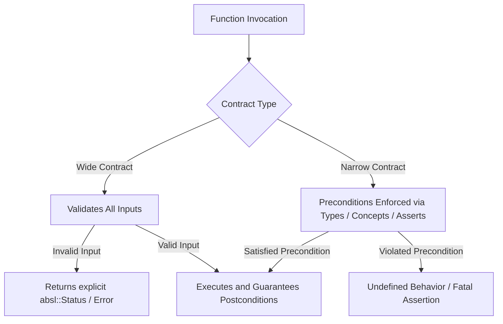
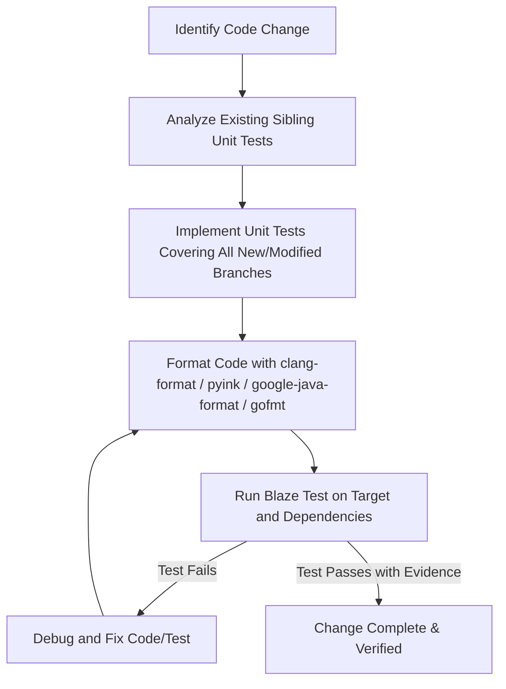

# Expert Coding & System Design Guidelines

This skill defines the technical standards, architectural paradigms, and operational workflows for high-reliability Google3 development, specialized for Google Cloud Storage (GCS) and JPBatches infrastructure.

---

## 1. Core Engineering Principles

### 1.1 Minimal Change Principle
* **Surgical Precision**: Confine diffs strictly to what is required to solve the task, fix the bug, or implement the feature.
* **Avoid Scope Creep**: Do not perform opportunistic refactoring, style reformatting of untouched code, or unrelated renamings in the same change.
* **Preserve Intent & Comments**: Maintain existing non-stale comments, documentation, and design rationales untouched.

### 1.2 Keep It Simple, Stupid (KISS) & YAGNI
* **Simplicity Over Cleverness**: Code is read far more often than it is written. Prefer straightforward, idiomatic control flow over intricate meta-programming or deep inheritance hierarchies.
* **No Speculative Generalization**: Solve the concrete problem at hand. Do not create multi-layered abstractions for hypothetical future extensions unless explicitly required.

---

## 2. Multi-Language Google Best Practices & Formatting

Strict adherence to Google Style Guides and language-specific idiomatic patterns is mandatory.

### 2.1 C++ Standards (C++20 Mandatory)
* **Modern Idioms**: Exclusively write modern C++20. Eliminate legacy idioms:
  * ❌ No raw `new`/`delete` (use `std::make_unique`, `std::make_shared`).
  * ❌ No `NULL` or `0` for pointers (use `nullptr`).
  * ❌ No C-style casts (use `static_cast`, `reinterpret_cast`, `bit_cast`).
  * ❌ No `typedef` (use `using`).
  * ❌ No unconstrained SFINAE (use C++20 `concept` and `requires` clauses).
* **Vocabulary Types**: Use `absl::string_view`, `std::span`, `absl::Status`, `absl::StatusOr`, and `std::optional` instead of output parameters or sentinel return values.
* **Resource Management (RAII)**: All resources (file descriptors, locks, RPC clients, heap allocations) must be strictly bound to object lifetimes.
* **Formatting**: Format using `clang-format -style=Google`.

### 2.2 Python Standards
* **Type Annotations**: Comprehensive PEP 484 type annotations for all function signatures and non-trivial local variables.
* **Error Handling**: Use explicit, standard exceptions (`ValueError`, `KeyError`, `RuntimeError`) or domain-specific exceptions. Never use bare `except:`.
* **Resource Safety**: Always use context managers (`with` statements) for I/O and resource lifecycle handling.
* **Formatting & Linting**: Strictly adhere to `pyink` / `yapf --style=google` and ensure code passes `pytype` / `flake8`.

### 2.3 Java Standards
* **Immutability by Default**: Mark classes and fields `final` wherever possible. Use `@AutoValue` or Java record types for immutable data carriers.
* **Nullability Contracts**: Annotate public APIs with `@Nullable` / `@NonNull` (or JSpecify annotations).
* **Collections & Streams**: Prefer Guava immutable collections (`ImmutableList`, `ImmutableMap`, `ImmutableSet`) and functional stream operations where readability is preserved.
* **Formatting**: Strictly format using `google-java-format`.

### 2.4 Go Standards
* **Effective Go**: Follow standard Google Go conventions.
* **Error Handling**: Treat errors as explicit return values. Wrap errors with contextual details using `fmt.Errorf("...: %w", err)`.
* **Context Propagation**: Always pass `ctx context.Context` as the first argument in blocking, I/O, or RPC functions.
* **Formatting**: Strictly format using `gofmt` and `goimports`.

---

## 3. Design by Contract & Contract-Driven Engineering

Every API, function, and class must operate under explicitly documented contracts with defined preconditions, postconditions, and invariants.



### 3.1 Wide vs. Narrow Contracts
* **Wide Contracts**:
  * Has **no preconditions** on input values; well-defined behavior is guaranteed for the entire domain of parameter types.
  * Invalid inputs are gracefully reported using explicit error return types (`absl::StatusOr<T>`, `Result<T, E>`, or `error`).
  * **When to use**: Public service boundaries, RPC handlers, user-facing interfaces, configuration parsers, and untrusted boundaries.
* **Narrow Contracts**:
  * Relies on **explicit preconditions** that caller must fulfill (e.g., pointer non-null, index `< size()`, buffer aligned).
  * Violations are programming bugs (developer errors), handled via `DCHECK`, `static_assert`, or C++20 `requires` constraints.
  * **When to use**: Internal performance-critical inner loops, private helpers, and low-level data structures where redundant validation creates unacceptable overhead.

### 3.2 Invariants and Postconditions
* Use RAII and immutable value wrappers to guarantee structural invariants across the entire object lifecycle.
* Ensure strong exception/error safety guarantees: operations either succeed completely or leave the state unmodified.

---

## 4. Advanced C++20 Architecture & Paradigms

### 4.1 Compile-Time Programming & Metaprogramming
* **`constexpr` / `consteval` / `constinit`**: Maximize computation at compile time. Shift invariant validation, table generation, and hashing from runtime to compilation.
* **`if constexpr`**: Replace template specializations and SFINAE with branch evaluation at compile time.
* **`static_assert`**: Provide clear compile-time assertions for invariants, type traits, and alignment requirements:
  ```cpp
  static_assert(sizeof(CompactHeader) == 64, "Header must fit single cache line");
  static_assert(alignof(CompactHeader) == 64, "Header must be cache-line aligned");
  ```

### 4.2 C++20 Concepts & Constrained Generics
* Always constrain templates using `template <typename T> requires ...` or named concepts:
  ```cpp
  template <typename T>
  concept SerializablePayload = requires(T a, absl::Cord& cord) {
    { a.AppendToCord(cord) } -> std::same_as<absl::Status>;
    { a.ByteSize() } -> std::convertible_to<size_t>;
  };

  template <SerializablePayload T>
  absl::Status TransmitMessage(const T& payload);
  ```
* **Template Pragmatism**: Only introduce templates when they provide genuine type-safety or zero-cost algorithmic reuse. Do not use templates when dynamic polymorphism (`std::unique_ptr<Interface>`) or simple overloading yields cleaner, faster-compiling code.

### 4.3 C++20 Coroutines: Pragmatic Evaluation
* **When Coroutines Add Real Value**:
  * High-throughput asynchronous streaming I/O pipelines (e.g., reading/writing chunked streams across storage backends).
  * State machines with complex sequential interleaving or backpressure control.
* **When to Avoid Coroutines**:
  * Simple synchronous code or straightforward single-hop RPCs.
  * Performance-sensitive tight loops where heap frame allocation overhead (`operator new` for coroutine frames) cannot be elided by the compiler (HALO - Heap Allocation of Coroutine Frames Optimization).
  * Always benchmark and verify that coroutines simplify the architecture rather than introducing hidden lifetime bugs.

### 4.4 Functional Programming Paradigms
* Favor pure, side-effect-free functions.
* Use immutability (`const`, `constexpr`) by default.
* Utilize monadic operations on optionals and error wrappers (e.g., transform, and_then composition) to express linear transformation pipelines without nested branching.

---

## 5. Performance, Memory Hierarchy & Hardware Efficiency

```
+-------------------------------------------------------------+
| L1 / L2 Data Cache (64-byte Cache Lines)                   |
| [ Object Header (16B) | Packed Fields (40B) | Padding (8B) ]|
+-------------------------------------------------------------+
                            |
           (Avoid False Sharing across Cores)
                            |
+---------------------------+---------------------------------+
| Thread 1 Atomic (64B aligned) | Thread 2 Atomic (64B aligned)|
+-------------------------------+------------------------------+
```

### 5.1 Algorithmic Complexity (Big O) & Container Selection
* Analyze time and space complexity for all data structures and algorithms:
  * Prefer contiguous memory containers (`std::vector`, `absl::InlinedVector<T, N>`, `std::array`) over node-based containers (`std::list`, `std::map`).
  * Use cache-friendly hash tables (`absl::flat_hash_map`, `absl::flat_hash_set`) for $O(1)$ lookups instead of tree-based maps ($O(\log N)$ with cache-miss pointer chasing).
  * For small collections ($N \le 32$), linear scans over contiguous flat arrays often outperform hash table lookups due to branch prediction and hardware prefetching.

### 5.2 Memory Alignment, Structure Packing & Cache Locality
* **Field Ordering**: Order struct/class members from largest to smallest to minimize compiler padding holes.
* **Cache Line Alignment**:
  * Prevent false sharing in concurrent multi-threaded data structures by aligning atomic variables to 64 bytes (`alignas(absl::kCacheLineSize)` or `alignas(64)`).
* **Data Locality**: Organize data in Structure-of-Arrays (SoA) rather than Array-of-Structures (AoS) when processing batched uniform transformations to maximize SIMD vectorization and cache line utilization.

### 5.3 Zero-Copy & Lifetime Semantics
* Use `std::move` and pass heavy objects by rvalue reference where ownership transfer occurs.
* Use non-owning views (`absl::string_view`, `std::span<const T>`, `absl::Cord`) to avoid memory copies during parsing, slicing, and serialization.

---

## 6. GCS & JPBatches Domain Architecture

Specialized architectural rules and patterns for Google Cloud Storage (GCS), Blobstore2, and JPBatches systems.

### 6.1 ValidatedProto CRTP Pattern
In Blobstore2 / JPBatches, wrap protobufs in strongly-typed domain model classes inheriting from `ValidatedProto` to guarantee structural integrity:

```cpp
#include "blobstore2/metadata/api/validated_proto.h"
#include "blobstore2/metadata/api/jpbatches/window_id.pb.h"

namespace blobstore2::metadata {

class WindowId : public ValidatedProto<WindowId, WindowIdProto> {
 public:
  static absl::Status Validate(const WindowIdProto& proto);
  static absl::StatusOr<WindowId> Create(absl::string_view raw_id);

  absl::string_view id() const;

 private:
  friend class ValidatedProto;

  explicit WindowId(WindowIdProto validated_proto)
      : ValidatedProto(std::move(validated_proto)) {}
};

}  // namespace blobstore2::metadata
```

* **Core Rules**:
  * Wrappers are **immutable** and expose only const accessors.
  * Direct construction is private; creation is gated through `ValidatedProto::Wrap(proto)` or static factory methods returning `absl::StatusOr<T>`.
  * Mutations require `.ToBuilder()` -> modify -> `.Build()` which re-validates before returning the wrapped object.

### 6.2 JPBatches Concurrency, Spanner & Paxos Guarantees
* **Linearizability & Read Lease Guarantees**:
  * Be acutely aware of Spanner read lease holder timestamp tracking ($T_{min}$ vs. $T_{read}$).
  * When soft-deleting objects or emitting changelog fragments (`ChangelogFragment`), ensure snapshot reads do not race with out-of-order replay callbacks.
* **Object Mutation Indexer & Queue Processing**:
  * Follow idempotency contracts in `ObjectMutationIndexingQueueReceiver` message handlers.
  * Ensure message processing is resilient to duplicate deliveries and out-of-order batch arrivals.

### 6.3 Canary Analysis Service (CAS) & Rollout Protocols
* **Turn-Up & Traffic Ramp-Up Latency Spikes**:
  * Temporary latency spikes in `ProcessMessages` during regional turn-up or ramp-up trigger shared `minimal` CAS checks, resulting in `CdPushVersionsOutOfSync` alerts.
  * Latency CAS checks can be silenced during planned ramp-up operations per playbook.
* **Error-Ratio CAS Failures (NEVER Silence)**:
  * `FrameworkActionServerErrorsHigh` or elevated RPC error ratios indicate real regressions (e.g., schema desync, unhandled soft delete bursts). Never silence error-ratio CAS failures without root-cause resolution.

---

## 7. Testing, Verification & Coverage Protocol

A change is incomplete until it is tested, verified, and proven regression-free.



### 7.1 Unit Test Coverage & Parity
* **Check Coverage**: Every new code path, conditional branch, error code return, and edge case must have corresponding unit test coverage.
* **Sibling Test Exploration**: Inspect existing `*_test.cc`, `*_test.py`, `*Test.java`, or `*_test.go` in the same directory. Match their:
  * Fixtures, test harnesses, and mock frameworks.
  * Hermetic environment configuration and parameterization patterns.
  * Assertion styles (`EXPECT_THAT`, `ASSERT_OK_AND_ASSIGN`, `assert_that`).

### 7.2 Strict Verification Workflow
Before declaring any task, bugfix, or feature complete:
1. Locate all directly affected test targets and downstream dependents.
2. Execute the tests via Blaze:
   ```bash
   SKYBUILD=1 /google/bin/releases/arca9-local-blaze-cli/blaze-for-agents test //path/to/package:target_test
   ```
3. Confirm that tests execute cleanly with `PASSED` status and zero test flakiness or regressions.
4. Verify formatting across all touched files before commit.
